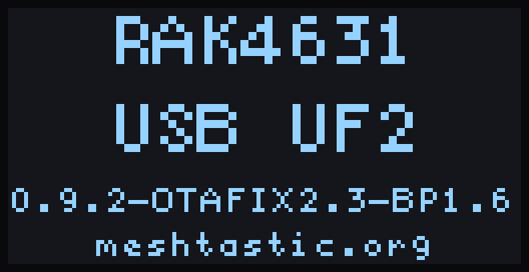
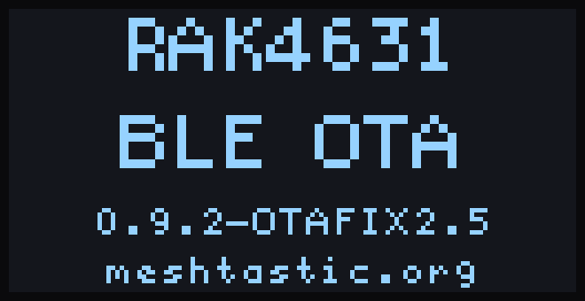

# Meshtastic nRF52 Bootloader

[](https://github.com/meshtastic/nRF52_Bootloader/actions/workflows/githubci.yml)
[](./LICENSE)

Adafruit nRF52 bootloader with enhanced OTA DFU, forked for [Meshtastic](https://meshtastic.org) from [oltaco's OTAFIX bootloader](https://github.com/oltaco/Adafruit_nRF52_Bootloader_OTAFIX), itself a fork of [Adafruit's nRF52 bootloader](https://github.com/adafruit/Adafruit_nRF52_Bootloader). It was previously called the OTAFIX bootloader. This is the bootloader several nRF52-based Meshtastic devices ship with, and the one the [Meshtastic Android app](https://github.com/meshtastic/Meshtastic-Android) can upgrade in-app.

Current release: **OTAFIX 2.5** (tag `0.9.2-OTAFIX2.5`). `master` carries the unreleased **2.6.0**; releases from 2.6.0 on are tagged plain `x.y.z`. See [changelog.md](changelog.md) for version history. Where this page says "2.6.0 and later", the behavior is on `master` and in every release from 2.6.0.

## Contents

- [How this fits together](#how-this-fits-together)
- [Boards supported](#boards-supported)
- [BLE advertising names](#ble-advertising-names)
- [Installation](#installation)
  - [Entering UF2 mode](#entering-uf2-mode)
  - [The UF2 drive](#the-uf2-drive)
  - [Updating the bootloader](#updating-the-bootloader)
  - [Backing up the installed firmware](#backing-up-the-installed-firmware)
  - [Factory erase](#factory-erase)
- [DFU screens](#dfu-screens)
- [Bootloader upgrade from the Meshtastic Android app](#bootloader-upgrade-from-the-meshtastic-android-app)
- [Troubleshooting](#troubleshooting)
- [Recommended OTA DFU settings](#recommended-ota-dfu-settings)
- [Notes on Xiao NRF52840 BLE](#notes-on-xiao-nrf52840-ble)
- [Notes on RAK4631 bootloader](#notes-on-rak4631-bootloader)
- [Notes on single-button boards: T1000-E and MeshTracker X1](#notes-on-single-button-boards-t1000-e-and-meshtracker-x1)
- [Contributing](#contributing)
- [Getting help](#getting-help)
- [License](#license)

---

## How this fits together

This repo builds **only the bootloader**, the small program that runs
before anything else on the device. It does not contain the Meshtastic
application (the LoRa mesh, BLE, and display code); that's built entirely
separately in [`meshtastic/firmware`](https://github.com/meshtastic/firmware).
This bootloader's job is just to start that application, or, when asked,
replace it (or itself) with a new version.

On every power-up or reset, a tiny fixed piece of code at the very start of
flash, Nordic's **MBR**, hands off to this bootloader. From there, the
bootloader either:

- boots straight into the installed Meshtastic application, or
- if no valid application is installed, or the user has asked for it, waits
  for a new one.

A new application image, or occasionally the bootloader itself, can be
installed three different ways:

| Method | Transport | Typical use |
|---|---|---|
| **UF2 drag-and-drop** | USB, appears as a drive | Manual flashing, see [Installation](#installation) |
| **Serial DFU** | USB, appears as a serial port | Recovery, and flashing a full bootloader+SoftDevice package with `adafruit-nrfutil`, see [Installation](#installation) |
| **BLE OTA DFU** | Bluetooth, no cable needed | The Meshtastic Android app's firmware/bootloader update, and any Nordic DFU app, see [below](#bootloader-upgrade-from-the-meshtastic-android-app) and [recommended settings](#recommended-ota-dfu-settings) |

There is also one thing the UF2 drive accepts that is *not* an image: the
[factory-erase file](#factory-erase), which wipes the application's saved
data in place and leaves everything else alone.

BLE OTA DFU is the only *wireless* path, and it is the bootloader's fallback
when nothing else applies: since **OTAFIX 2.0**, a device with no valid
application waits in BLE OTA mode rather than risk getting stuck. From
**2.6.0** that device first checks for a USB cable: on a host it comes up as
a UF2 drive showing NO FIRMWARE, and only on battery, or on a charger with no
host, does it go to the BLE OTA wait. The full routing is under
[The UF2 drive](#the-uf2-drive).

The application also relies on Nordic's **SoftDevice**, a closed-source,
precompiled Bluetooth stack (vendored here as a hex blob under
`lib/softdevice/`) that sits in flash alongside it. The bootloader and the
application both call into it for BLE, so bootloader and SoftDevice
versions are usually flashed together as a matched pair (that's why the
[Installation](#installation) instructions below mention flashing "a full
bootloader and SoftDevice zip package"). Each board builds against one
SoftDevice version, S140 6.1.1 or S140 7.3.0, listed in the table below. A
UF2 built for the other SoftDevice is rejected (2.6.0 and later), and the
`SoftDevice:` line in `INFO_UF2.TXT` on the UF2 drive shows which one a
device has.

---

## Boards supported

| Board | `BOARD=` name | SoftDevice | DFU screen |
| --- | --- | --- | --- |
| Elecrow ThinkNode M1 | `thinknode_m1` | S140 6.1.1 | |
| Elecrow ThinkNode M3 | `thinknode_m3` | S140 6.1.1 | |
| Elecrow ThinkNode M6 | `thinknode_m6` | S140 6.1.1 | |
| Heltec T096 | `heltec_t096` | S140 6.1.1 | SPI TFT |
| Heltec T1 | `heltec_t1` | S140 6.1.1 | SPI TFT |
| Heltec T114 / HT-nRF5262 | `heltec_t114` | S140 6.1.1 | SPI TFT |
| LilyGO T-Echo | `lilygo_techo` | S140 6.1.1 | |
| Minewsemi MX25LE01 | `minewsemi_mx25le01` | S140 7.3.0 | |
| MuziWorks Base Uno / Base Duo / Superbase | `muzi_base` | S140 6.1.1 | |
| Meshtastic Generic, S140 6.1.1 | `meshtastic_6.1.1` | S140 6.1.1 | |
| Meshtastic Generic, S140 7.3.0 | `meshtastic_7.3.0` | S140 7.3.0 | |
| Nologo ProMicro NRF52840 (aka SuperMini NRF52840) | `promicro_nrf52840` | S140 6.1.1 | I2C OLED |
| RAK 3401 | `wiscore_rak3401` | S140 6.1.1 | I2C OLED |
| RAK 4631 ([See note](#notes-on-rak4631-bootloader)) | `wiscore_rak4631_board` | S140 6.1.1 | I2C OLED |
| RAK WisMesh Tag | `wismesh_tag` | S140 6.1.1 | |
| Seeed Studio SenseCAP Card Tracker T1000-E ([See note](#notes-on-single-button-boards-t1000-e-and-meshtracker-x1)) | `t1000_e` | S140 7.3.0 | |
| Seeed Studio SenseCAP MeshTracker X1 ([See note](#notes-on-single-button-boards-t1000-e-and-meshtracker-x1)) | `mesh_tracker_x1` | S140 7.3.0 | |
| Seeed SenseCAP Solar Node P1 | `sensecap_solar_p1` | S140 7.3.0 | |
| Seeed Studio Wio Tracker L1 | `wio_tracker_l1` | S140 7.3.0 | I2C OLED |
| Seeed Studio Wio Tracker L1 Pro 1W | `wio_tracker_l1_pro_1w` | S140 7.3.0 | |
| Seeed Studio XIAO nRF52840 BLE ([See note](#notes-on-xiao-nrf52840-ble)) | `xiao_nrf52840_ble` | S140 7.3.0 | I2C OLED |
| Seeed Studio XIAO nRF52840 BLE SENSE | `xiao_nrf52840_ble_sense` | S140 7.3.0 | I2C OLED |

The `BOARD=` name is the directory under `src/boards/` and the prefix of the release asset file names (`update-<name>_bootloader-<version>_nosd.uf2`, `<name>_bootloader-<version>_s140_<softdevice>.zip`). The DFU screen column says which boards show a screen while in DFU mode; see [DFU screens](#dfu-screens).

**Meshtastic Generic** (2.6.0 and later) is for DIY nRF52840 boards that have no board-specific bootloader. Pick the variant whose SoftDevice your firmware build expects. It drives no LED, and its only button is the reset pin (P0.18), so it claims no GPIO: enter UF2 mode by double-pressing reset, or from the application. The two variants report Board-IDs `nRF52840-Meshtastic-Generic-S140v6` and `nRF52840-Meshtastic-Generic-S140v7` in `INFO_UF2.TXT` and share USB ID `239A:0029` with the RAK4631, RAK3401, T-Echo, WisMesh Tag and MX25LE01, so their `update-` UF2 installs over those boards' bootloaders and the reverse (see [Updating the bootloader](#updating-the-bootloader)). These two builds have not been run on hardware by the maintainers.

If there is another nRF52840-based Meshtastic board you would like to see supported, please [raise a GitHub issue](https://github.com/meshtastic/nRF52_Bootloader/issues/new/choose), or see [Adding a new board](./CONTRIBUTING.md#adding-a-new-board) in `CONTRIBUTING.md` if you want to submit it yourself.

## BLE advertising names

When in OTA DFU mode, devices advertise using a board-specific name rather than the generic `AdaDFU`.

| Board                        | OTA DFU advertising name |
| ---------------------------- | ------------------------ |
| Elecrow ThinkNode M1         | `TNM1_DFU`               |
| Elecrow ThinkNode M3         | `TNM3_DFU`               |
| Elecrow ThinkNode M6         | `TNM6_DFU`               |
| Heltec T096                  | `T096_DFU`               |
| Heltec T1                    | `T1_DFU`                 |
| Heltec T114                  | `T114_DFU`               |
| LILYGO T-Echo                | `LGTE_DFU`               |
| Minewsemi MX25LE01           | `MX25_DFU`               |
| MuziWorks Base / Superbase   | `MUZI_DFU`               |
| Meshtastic Generic           | `MESH_DFU`               |
| ProMicro NRF52840            | `PROM_DFU`               |
| RAK 4631                     | `4631_DFU`               |
| RAK 3401                     | `3401_DFU`               |
| RAK WisMesh Tag              | `RTAG_DFU`               |
| Seeed MeshTracker X1         | `MTX1_DFU`               |
| Seeed SenseCAP Solar Node P1 | `SCAP_DFU`               |
| Seeed T1000e                 | `T1KE_DFU`               |
| Seeed WioTracker L1          | `WTL1_DFU`               |
| Seeed WioTracker L1 Pro 1W   | `WTLP_DFU`               |
| XIAO NRF52 BLE / SENSE       | `XIAO_DFU`               |

The device advertises at the application's BLE address plus one, and exposes its bootloader version through the Device Information Service (firmware revision, `0x2A26`).

---

## Installation

The recommended way to install the bootloader is using the UF2 file.  
Download the UF2 file for your board (they can be found in the [releases](https://github.com/meshtastic/nRF52_Bootloader/releases) with filenames beginning with `update-`), enter UF2 mode and copy the UF2 file across. The board installs it and reboots into the application; see [Updating the bootloader](#updating-the-bootloader) for what the bootloader checks first.

If an incorrect bootloader has been flashed to the device, a full bootloader and SoftDevice zip package will need to be flashed using `adafruit-nrfutil` over serial DFU:

```sh
adafruit-nrfutil dfu serial --package <board>_bootloader-<version>_s140_<softdevice>.zip --port <serial port> -b 115200
```

That package replaces the SoftDevice too, which marks the installed application invalid: the device does not boot the application afterwards. On a USB host it comes up as a UF2 drive showing NO FIRMWARE (2.6.0 and later; OTAFIX 2.x goes to the BLE OTA wait instead), so copy the firmware `.uf2` across next.

### Entering UF2 mode

- **Double-press reset** within half a second. The drive comes up with no host timeout and stays until you copy a file, eject, or reset (or, from 2.6.0, until 6 minutes pass with no activity on a board with a valid application).
- **Hold the button through power-on** on the single-button boards, see the [single-button note](#notes-on-single-button-boards-t1000-e-and-meshtracker-x1).
- **From the application**, with no button: `meshtastic --enter-dfu` over USB, or the Meshtastic Android app's firmware-update screen on a USB connection. A board sent to UF2 mode this way needs a USB host within 3 seconds, otherwise it boots the application again.
- **A device with no valid application** goes to the drive on its own whenever a USB host is attached (2.6.0 and later).

Holding the DFU button while the board resets enters **BLE OTA mode**, not UF2 mode, on every board except the single-button boards. UF2 mode comes from double reset, the button hold on those boards, or the application.

### The UF2 drive

The drive is named after the board (`RAK4631`, `XIAO-BOOT`, `T1000-E`, and so on) and holds three files:

- `INFO_UF2.TXT`: the bootloader version, board model and `Board-ID:`, the installed `SoftDevice:` version, a `Factory-Erase:` line on bootloaders that accept the [factory-erase file](#factory-erase), and (2.6.0 and later) a `Last-Fault:` line if the bootloader recorded a fault, see [Troubleshooting](#troubleshooting).
- `CURRENT.UF2`: a dump of the installed application, see [Backing up](#backing-up-the-installed-firmware).
- `INDEX.HTM`: a redirect to the board vendor's page (the firmware repo on the generic boards).

Copy one `.uf2` file onto the drive at a time. What happens next depends on the file:

- **A firmware image** is written as it arrives, and on boards with a screen a progress bar shows how far along it is (2.6.0 and later). Once the whole file has arrived the drive detaches and the board boots the new application. From 2.6.0 the old application is marked invalid as soon as the first application block is written, so a copy interrupted by a pulled cable or a power loss leaves the board with no application, which brings the drive back up for a second try, instead of a half-written image that boots.
- **A firmware image built for the other SoftDevice** (2.6.0 and later) is rejected: nothing is written, the drive stays up, and a board with a screen shows WRONG FILE. The check assumes the host writes the file front to back, which is what Linux does; copies from macOS and Windows have not been exercised. Images that carry their own SoftDevice, and `CURRENT.UF2` restores, pass the check.
- **A bootloader update** (`update-*.uf2`) is checked and installed as described under [Updating the bootloader](#updating-the-bootloader).
- **The factory-erase file** erases the application's data, see [Factory erase](#factory-erase).
- **A UF2 of an unknown family**, or a bootloader update for a board with a different USB ID, is rejected, and a board with a screen shows WRONG FILE. A rejected bootloader update ends the session: the drive detaches and the board boots the application if it has one. Files that are not UF2 are ignored. The bootloader cannot tell one board's firmware image from another's on the same SoftDevice, so check the file name before copying it.

Routing when the device has **no valid application** (2.6.0 and later):

- On a USB host it comes up as the UF2 drive showing NO FIRMWARE.
- On battery (no VBUS) it goes straight to the BLE OTA wait.
- On a charger or power bank (VBUS, but no host enumerating it within 3 seconds) it falls through to the BLE OTA wait.
- Pulling the cable while the drive is up sends it to the BLE OTA wait.
- Plugging a cable into a device that is waiting for BLE OTA, with no phone connected, brings the drive up. A cable that was already present when the wait began, or a phone that is connected, leaves the wait alone.
- A rejected or aborted copy returns it to the drive, as does an eject on the [single-button boards](#notes-on-single-button-boards-t1000-e-and-meshtracker-x1).

A device **with** a valid application that is left in DFU mode boots the application after 6 minutes with no activity (2.6.0 and later): a BLE connection or DFU transfer, a read or write of the drive, a USB host enumerating it, or serial DFU traffic restarts the 6 minutes, and an idle BLE link does not. Before 2.6.0 the device stays in DFU until reset.

### Updating the bootloader

Copying `update-<board>_bootloader-<version>_nosd.uf2` onto the drive stages the new bootloader, checks it, and installs it over the running one; the board then reboots into the application. Boards with a screen show BOOTLOADER while it is staged.

The bootloader accepts an update whose USB vendor and product ID match its own and rejects any other. Several boards share an ID, so the bootloader cannot tell their update files apart and installs the other board's file without complaint:

| USB ID | Boards that share it |
| --- | --- |
| `239A:0029` | RAK4631, RAK3401, T-Echo, WisMesh Tag, MX25LE01, Meshtastic Generic (both) |
| `239A:0071` | Heltec T096, T1, T114 |
| `239A:00DA` | ThinkNode M1, M3, M6 |
| `2886:0044` | SenseCAP Solar Node P1, XIAO nRF52840 BLE |
| `2886:0057` | T1000-E, MeshTracker X1 |
| `2886:1667` | Wio Tracker L1, L1 Pro 1W |

Check the file name against your board before copying it. `Board-ID:` in `INFO_UF2.TXT` tells you which bootloader is installed now.

From 2.6.0, if the installed application is large enough that the staged bootloader would overwrite its tail (larger than 744 KB on S140 6.1.1 or 740 KB on 7.3.0), the application is marked invalid before staging and the device comes up on the drive showing NO FIRMWARE, instead of booting a corrupted application. Copy the firmware `.uf2` across again. Current Meshtastic firmware images are smaller than this.

### Backing up the installed firmware

`CURRENT.UF2` on the UF2 drive is a dump of the application currently in flash. Copy it off to keep a backup, and copy it back onto the drive to reinstall that application. Since OTAFIX 2.3-BP1.6 the dump is sized from the application start, so it is byte-for-byte the image that was installed; a dump taken with BP1.5 or older after a serial or BLE OTA update could be silently truncated, so re-take any backup made that way. Verified on a RAK4631: restore boots, and the next dump matches byte for byte.

If the bootloader does not know the application's size (after a debug-probe flash, for example), the dump covers the whole application region instead. Such a dump still restores and boots.

### Factory erase

To wipe the device's saved data (config, node DB, keys, BLE bonds) without a serial terminal or a special erase firmware: enter UF2 mode and copy [`meshtastic_factory_erase.uf2`](./tools/meshtastic_factory_erase.uf2) (also attached to every [release](https://github.com/meshtastic/nRF52_Bootloader/releases)) onto the drive. The bootloader erases the application's data region, then reboots straight back into UF2 mode so you can copy the firmware across next. The application itself is left in place, so if you unplug instead, it boots factory-fresh. Copy this file on its own: the drive detaches about half a second after the copy finishes (or as soon as you eject it) and comes back a second or two later. Boards with a screen show ERASE while it runs.

The file is the same for every board. It is a single UF2 block with family ID `0x4D455348` and no payload; a bootloader that predates OTAFIX 2.4 ignores it silently. Check `INFO_UF2.TXT` on the drive for a `Factory-Erase:` line to know whether yours supports it. Regenerate it with `tools/make_factory_erase_uf2.py` (or `make factory-erase-uf2`).

---

## DFU screens

Boards marked in the [board table](#boards-supported) show a screen while in DFU mode: the Heltec T096, T1 and T114 on their SPI TFT, and (2.6.0 and later) the RAK4631, RAK3401, Wio Tracker L1, ProMicro nRF52840 and both XIAO nRF52840 boards on a 128x64 I2C OLED at address 0x3C or 0x3D. The OLED path reads the controller type (SSD1306 or SH1106) off the panel; a board with no panel attached shows nothing and otherwise behaves the same. On the RAK4631 and RAK3401 the bootloader powers the switched 3V3_S rail that feeds the WisBlock slots while in DFU, and turns it off again if no panel answers.

The OLED shows the board name, the mode (`USB UF2` or `BLE OTA`), the bootloader version, and a banner line; the TFT shows the same first and last lines with a drag-and-drop picture (`firmware.uf2` to the drive's volume label) or `BLE OTA` between them:

| | |
| --- | --- |
|  |  |

(These two are rendered from the OLED drawing code, not photographed, and show the version stamp of a 2.5 build.)

From 2.6.0 the first line changes to say what the bootloader is doing, and the banner line becomes a progress bar during a UF2 copy, a serial DFU or a BLE OTA transfer:

| Title | Meaning |
| --- | --- |
| `NO FIRMWARE` | DFU started because there is no valid application. Copy a firmware `.uf2` across, or run a BLE OTA update. |
| `WRONG FILE` | The last UF2 block was rejected: unknown family, a bootloader update for another USB ID, or a firmware image for the other SoftDevice. Nothing was written by that block. |
| `BOOTLOADER` | An `update-*.uf2` bootloader update is being staged. |
| `ERASE` | The factory-erase file was received. |

---

## Bootloader upgrade from the Meshtastic Android app

The [Meshtastic Android app](https://github.com/meshtastic/Meshtastic-Android) can flash this bootloader directly, with no manual UF2 drag-and-drop needed.

With the radio connected over **USB/serial** (not Bluetooth), open the connected radio's configuration, go to **Advanced → Firmware Update**, and where an upgraded bootloader is published for your board you'll see an **Upgrade bootloader** option alongside **Erase and reinstall**. The app reads `INFO_UF2.TXT` from the device's update drive first to confirm the board and Bluetooth stack before writing anything, and will ask you to select the update drive twice: once for the bootloader image, once for the firmware. See the app's [Firmware Updates guide](https://github.com/meshtastic/Meshtastic-Android/blob/main/docs/en/user/firmware.md) for the full flow.

---

## Troubleshooting

### Device does not appear as a USB drive or serial port

If the device does not show up on your computer after flashing the bootloader or performing an OTA update, it may be **waiting in OTA DFU mode**.

In **OTAFIX 2.0** and above, OTA DFU is the default state when no valid application is present. From **2.6.0**, a device with no valid application takes the UF2 drive instead whenever a USB host is attached, and reaches OTA DFU only on battery or on a charger; the full routing is under [The UF2 drive](#the-uf2-drive).

In OTA DFU mode:
- No UF2 drive is exposed
- No serial port is available
- The device is waiting for an OTA firmware update over BLE, advertising as its [board-specific name](#ble-advertising-names)

**What to do:**
- Perform an OTA update using a supported DFU app, **or**
- Explicitly request UF2/serial mode using **double-reset** (or the button hold on a [single-button board](#notes-on-single-button-boards-t1000-e-and-meshtracker-x1)), **or**
- On 2.6.0 and later, plug in a USB cable with no phone connected: the device leaves the wait and comes up as the drive. If the cable was already plugged in when the wait began, unplug it and plug it back in.

The OTA fallback is intentional and prevents devices from getting stuck in UF2 mode after failed OTA updates.

A device with a valid application that sits in DFU for 6 minutes with no activity (no BLE connection or DFU traffic, no drive access) boots its application (2.6.0 and later). A device with no valid application stays in DFU.

If the bootloader recorded a fault since the last UF2 drive session, `INFO_UF2.TXT` shows a `Last-Fault:` line with the fault id, program counter, and info word (2.6.0 and later). It appears only if the next boot reaches the drive before an application boots, since the application's RAM use wipes the record. Include the line in a bug report.

---

### OTA update fails with `Error: Operation Failed`

If an OTA update consistently fails early with `Error: Operation Failed`, this is often caused by BLE stack incompatibilities when **Request High MTU** is enabled.

**What to try:**
- Experiment with different PRN settings: try 12, 8, 1, or off altogether.
- Disable **Request High MTU** in the DFU app.

While high MTU significantly improves performance on supported devices, it is not required for a successful OTA update.

---

### OTA update stops partway, or finishes and the device stays in the bootloader

If the phone loses the BLE link in the middle of a transfer, the bootloader goes back to advertising. On 2.6.0 and later the phone can reconnect and start the transfer over without the device being reset; OTAFIX 2.x refuses the new transfer until the device is reset or power-cycled.

If an OTA update reports success but the device keeps advertising as `<BOARD>_DFU`, or comes up on the UF2 drive showing NO FIRMWARE, one known cause is a flash timeout while the bootloader saves the result (the SoftDevice could not fit the flash write between radio events). On 2.6.0 and later the write is retried, every 100 ms for up to 2 seconds, before the bootloader gives up, and if it does give up the drive's `INFO_UF2.TXT` shows `Last-Fault: id=0x4001 pc=0x0 info=0xd`; on OTAFIX 2.x the first timeout ends the update. The transfer itself was fine, so running the update once more completes it.

---

### The screen says WRONG FILE

The last UF2 block was not for this board: a UF2 of a family the bootloader does not know, a bootloader update for a board with a different USB ID, or a firmware image for the other SoftDevice. Nothing was written by that block. A firmware image for another board on the same SoftDevice is not caught, so check the file name. Copy the right file for your board; the drive is still up. See [The UF2 drive](#the-uf2-drive) and [Updating the bootloader](#updating-the-bootloader) for what the bootloader checks.

---

## Recommended OTA DFU settings

To perform the OTA update, use **nRF Device Firmware Update**  
([Android](https://play.google.com/store/apps/details?id=no.nordicsemi.android.dfu&hl=en&gl=US) / [iOS](https://apps.apple.com/sa/app/device-firmware-update/id1624454660))  
or **nRF Connect**  
([Android](https://play.google.com/store/apps/details?id=no.nordicsemi.android.mcp&hl=en&gl=US) / [iOS](https://apps.apple.com/gb/app/nrf-connect-for-mobile/id1054362403)).

**nRF Device Firmware Update** is the recommended app of the two.

For **OTAFIX 2.0** and later, including 2.6.0, the following settings are recommended (these may change; feel free to experiment and report findings via a GitHub issue):

<table>
<tr>
<td valign="top">

**Packet Receipt Notification (PRN):** ON  
**Number of packets:** 30  
**Reboot time:** 0ms  
**Scan timeout:** 2000ms  
**Request high MTU:** ON for Android (see notes below) / not available on iOS  
**Disable resume:** ON  
**Prepare object delay:** 0ms  
**Force scanning:** ON  
**Keep bond:** OFF  
**External MCU DFU:** OFF  

**Notes:**
- Some Android devices and BLE stacks do not behave well with **Request high MTU** enabled.  
  If the transfer fails early with `ERROR: Operation Failed`, retry with **Request high MTU turned OFF**.
- For maximum speed, Packet Receipt Notification can be disabled, and the number of packets increased.  
  Android is generally more tolerant of higher values; on iOS and other small-packet hosts, values above ~60 are not recommended.

</td>
</tr>
</table>

[Recommended settings for versions prior to 2.0 can be found here](docs/oldsettings.md).

**IMPORTANT:**  
On <u>older versions</u> of the bootloader, performing an OTA update while the device was connected to a computer USB host would complete successfully but **would not automatically boot into the new application firmware**, requiring a manual reset.  
This issue is fixed in **OTAFIX 2.0**.

---

## Notes on Xiao NRF52840 BLE

Many of these boards are shipped with the Sense version of the bootloader installed. If your board has the Sense version installed you must use the Sense version when updating via UF2.

You can look at the INFO_UF2.TXT file on the UF2 drive to check what version is currently installed.

To check:
1. Enter UF2 DFU mode (double-press reset) 
2. Open the `INFO_UF2.TXT` file on the mounted drive  

If the file shows: "Board-ID: nRF52840-SeeedXiaoSense-v1" then the ***SENSE*** variant must be used if updating via UF2 file.

The two variants have different USB product IDs (`2886:0044` and `2886:0045`), so the bootloader rejects the other variant's `update-` file.

## Notes on RAK4631 bootloader

This version of the RAK4631 bootloader is based on a much newer version (0.9.2) of the Adafruit nRF52 bootloader than what RAK Wireless uses on their official bootloader (0.6.2-11). It has been tested with no problems found; whether RAK's own patches to the Adafruit bootloader introduce any behavioral difference has not been investigated. A variant of the official RAK bootloader with these patches included instead is available [here](https://github.com/oltaco/WisCore_RAK4631_Bootloader/releases).

## Notes on single-button boards: T1000-E and MeshTracker X1

The SenseCAP Card Tracker T1000-E and the SenseCAP MeshTracker X1 each have a single user button, and their RESET line is wired to the MCU reset pin rather than a second button, so **double-press reset does not work on these boards**. From **OTAFIX 2.5** both use the same hold-to-enter scheme instead: with USB connected, hold the button while the device boots and keep holding for about 3 seconds. The bootloader enters UF2 DFU mode and mounts the mass-storage drive a few seconds later. Releasing the button before then boots the application as normal.

Because a momentary press belongs to the application, a short press will *not* enter DFU; it has to be an uninterrupted hold through boot. A hold while the application is already running belongs to the application too (on the T1000-E a long press powers the device off). To make the device boot with the button held, either power it on with the button down, or reboot it from a client while holding the button. The power-on case is deliberate: the application sets `DFU_MAGIC_SKIP` before powering off, and a board using the hold scheme keeps checking the button through that flag rather than skipping straight to the application.

To leave DFU mode, eject the mounted drive: the bootloader exits DFU and boots the application. There is no RESET button to fall back on, so this is the way out if you entered DFU and no longer want to copy firmware across. (Copying a `.uf2` across also reboots the board, as on any other board.) It has to be a real eject (`eject`, `udisksctl power-off`, or Finder/Explorer "Safely Remove"), since the bootloader only sees an eject as a SCSI START STOP UNIT. With no valid application, an eject brings the drive back instead (2.6.0 and later).

Unplugging is not a way out on OTAFIX 2.x: the board stays in the bootloader on battery, with no LED on the X1 to show it, and plugging it back in only mounts the drive again. From 2.6.0 a board with a valid application boots it after 6 minutes without activity, and a board with no application goes to the BLE OTA wait when the cable is pulled; ejecting the drive (or copying a `.uf2` across) is still the quick way out.

Before OTAFIX 2.5 the T1000-E had no button path into DFU at all (the bootloader read the button with the wrong polarity), and an eject did not leave DFU. On those bootloaders, enter UF2 mode from the application instead: `meshtastic --enter-dfu` or the Meshtastic Android app; then install the file for your board from the [releases](https://github.com/meshtastic/nRF52_Bootloader/releases) to get the button: `update-t1000_e_bootloader-*.uf2` on the T1000-E, `update-mesh_tracker_x1_bootloader-*.uf2` on the X1. The two boards share a USB VID/PID, which is what the bootloader's self-update check keys on, so it accepts the wrong board's file without complaint.

Avoid the 1200 bps serial touch on these boards: it selects serial-only DFU (`DFU_MAGIC_SERIAL_ONLY_RESET`), which exposes no drive, has no eject to leave by, and the serial DFU protocol carries no reset request. On OTAFIX 2.x the only way out is completing a serial DFU with `adafruit-nrfutil`. On 2.6.0 and later the 6-minute inactivity timer also applies to serial-only DFU, so a board with a valid application boots it on its own; that path has not been exercised on hardware.

---

## Contributing

Want to build from source, add a board, or submit a fix? See
[`CONTRIBUTING.md`](./CONTRIBUTING.md) for the development setup and PR
process, and [`AGENTS.md`](./AGENTS.md) for how the codebase is put
together.

## Getting help

- **Questions or troubleshooting:** [Meshtastic Discussions](https://github.com/orgs/meshtastic/discussions)
- **Bug reports and feature requests:** [open an issue](https://github.com/meshtastic/nRF52_Bootloader/issues/new/choose)
- **Security vulnerabilities:** see [`SECURITY.md`](./SECURITY.md), please do not open a public issue
- **General Meshtastic docs:** [meshtastic.org](https://meshtastic.org/)

## License

[MIT](./LICENSE), originally Copyright (c) 2016 Adafruit Industries.
